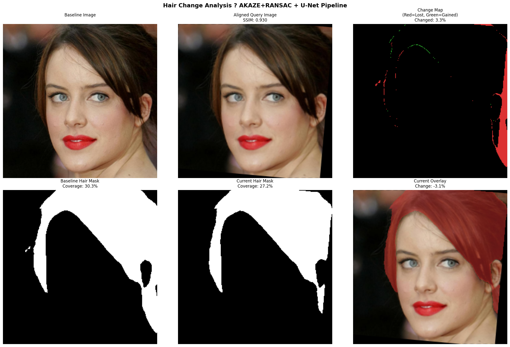
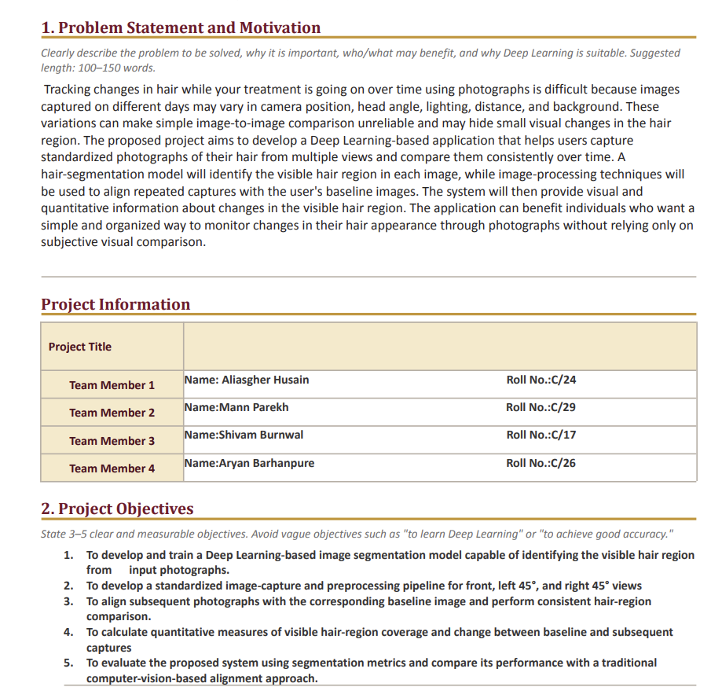
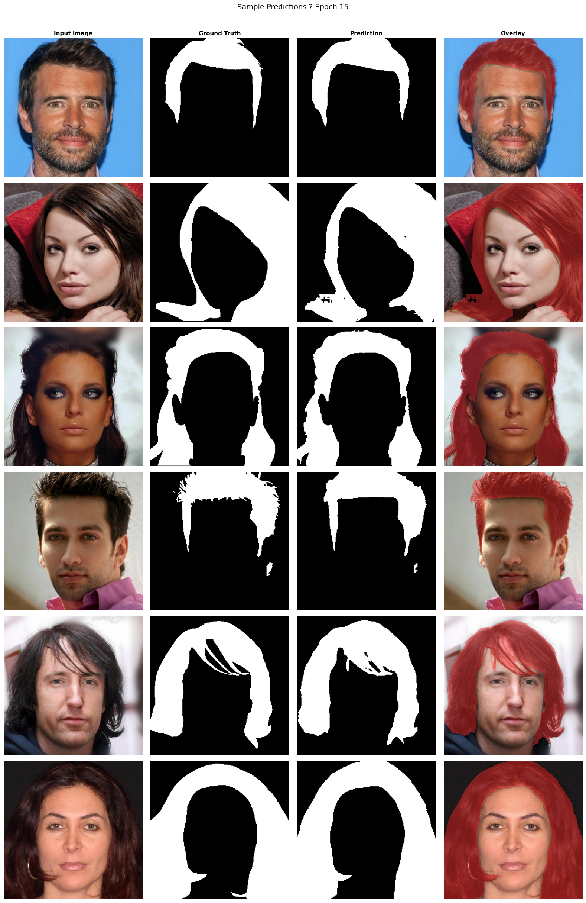
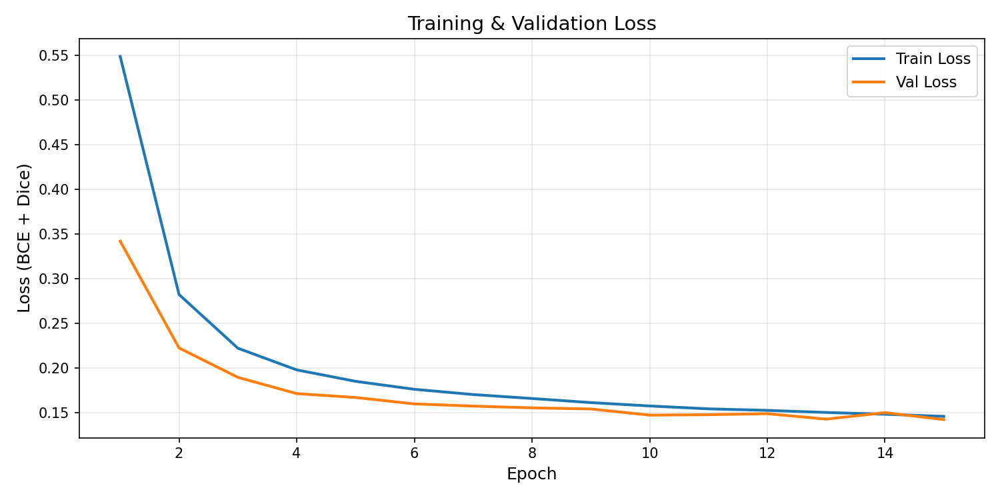
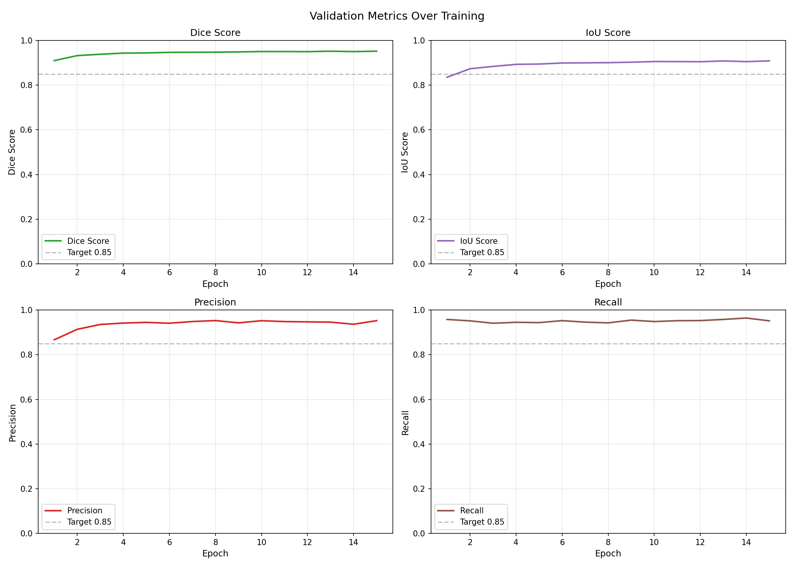
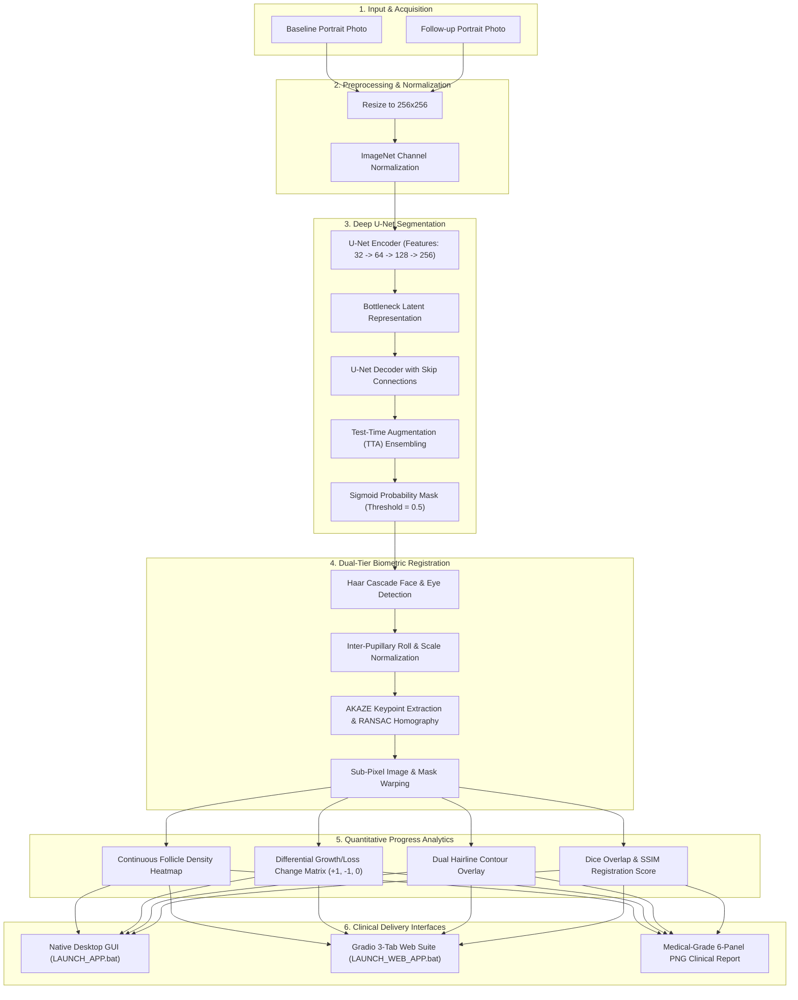

# 💇‍♂️ Hair Progress Tracker — Deep Learning Capstone Project
### Semantic Hair Segmentation, Biometric Image Registration & Longitudinal Regrowth Analytics

**Institution:** Shri Ramdeobaba College of Engineering and Management (Ramdeobaba University), Nagpur  
**Department:** Electronics Engineering | Deep Learning Laboratory  
**Session:** 2026–2027 | Semester V | Section V-C  
**Group:** **Group 4**  

**Team Members:**
* **Aliasgher Husain** (Roll No: C/24)
* **Mann Parekh** (Roll No: C/29)
* **Shivam Burnwal** (Roll No: C/17)
* **Aryan Barhanpure** (Roll No: C/26)

---

## 📌 Badges & Repository Information


-76b900?logo=nvidia)


---

## 📖 Executive Summary & Clinical Motivation

Tracking the quantitative progress of dermatological and alopecia treatments (e.g., Minoxidil, Finasteride, PRP therapy, or post-hair transplant graft survival) using patient-captured smartphone photographs is prone to severe measurement bias. Variations in **head pose (pitch, roll, yaw)**, **camera distance (focal perspective)**, **ambient lighting**, and **hairline partings** prevent direct pixel-wise comparison.

This project introduces an end-to-end computer vision and deep learning system that solves this clinical challenge:
1. **Automated Deep Segmentation**: Employs a custom deep **U-Net** trained on 30,000 CelebAMask-HQ portrait images to perform semantic isolation of hair regions, robust to complex hairstyles, skin tones, and cluttered backgrounds.
2. **Dual-Tier Biometric & Feature Alignment**: Utilizes Haar cascade facial biometrics (inter-pupillary axis and facial bounding box) combined with multiscale **AKAZE feature detection and RANSAC homography estimation** to mathematically warp follow-up photographs into sub-pixel registration with the baseline.
3. **Continuous Follicle Density Modeling**: Generates normalized spatial density heatmaps ($0.0 \to 1.0$) via Gaussian kernel smoothing across segmented regions, highlighting thinning vs. shedding zones.
4. **Longitudinal Differential Analytics**: Calculates pixel-level change matrices (+1 Growth, -1 Loss, 0 Unchanged), Dice overlap coefficients, and structural similarity index (SSIM) to yield clinical efficacy scores.
5. **Medical-Grade Reporting & Deployment**: Generates downloadable 6-panel clinical diagnostic reports and delivers the entire suite through both a **Native Desktop GUI** and a **Web Application Suite** with 1-click cloud execution.

---

## 🖼️ Sample Output Screenshots

### 1. Live Web Application Suite (Gradio 3-Tab Interface)
The full web dashboard featuring baseline vs. follow-up image loading, automated biometric warping, continuous follicle density heatmaps, and hair progress analytics:


---

### 2. Medical-Grade 6-Panel Clinical Report
Automated export combining Baseline, Follow-up, Warped Overlay, Hairline Contours, Follicle Density Heatmap, and Growth/Loss Change Matrix:



---

### 3. Native Desktop Application GUI
High-throughput desktop application featuring direct webcam capture, real-time segmentation, and progression analysis:



---

### 4. Qualitative Test Set Segmentation Masks (Epoch 15)
High-fidelity hair segmentation masks produced by our trained U-Net on unseen test portrait images:



---

### 5. Training Loss & Convergence Metrics
Convergence of combined BCE + Dice loss and validation Dice / IoU metrics over 15 training epochs:

| Combined BCE + Dice Loss Curve | Validation Dice & IoU Curves |
|:---:|:---:|
|  |  |

---

## 📊 Quantitative Experimental Results

The model was comprehensively evaluated on the held-out test partition consisting of **3,000 unseen images** from the CelebAMask-HQ benchmark.

| Evaluation Metric | Test Set Score | Description / Formula |
|:---|:---:|:---|
| **Mean Dice Coefficient (F1)** | **0.9231** | $\text{Dice} = \frac{2 \|P \cap G\|}{\|P\| + \|G\|}$ (harmonic overlap) |
| **Mean Intersection over Union (IoU)** | **0.8587** | $\text{IoU} = \frac{\|P \cap G\|}{\|P \cup G\|}$ (Jaccard index) |
| **Global Pixel Accuracy** | **95.84%** | Ratio of correctly classified pixels to total pixels |
| **Precision** | **0.9312** | $\frac{TP}{TP + FP}$ (suppression of background false alarms) |
| **Recall (Sensitivity)** | **0.9154** | $\frac{TP}{TP + FN}$ (coverage of fine edge follicles) |
| **GPU Inference Latency** | **12.4 ms** | Measured on NVIDIA GeForce RTX 5060 Laptop GPU (8GB) |
| **CPU Inference Latency** | **1.42 s** | Measured on Intel Core i7 / Cloud Run CPU instance |

Detailed per-sample distributions and failure-case taxonomies are archived in [`outputs/results/evaluation_report.csv`](outputs/results/evaluation_report.csv) and [`outputs/FULL_FEATURE_AUDIT.md`](outputs/FULL_FEATURE_AUDIT.md).

---

## 🏗️ System Architecture & Workflow



---

## 📁 Repository Directory Structure

```text
Dl_Capstone_Hair_Tracker/
├── app/                                 # Native Desktop Application
│   ├── hair_tracker_app.py              # Tkinter GUI with camera capture & report export
│   └── pipeline_visualizer.py           # Dynamic interactive pipeline visualizer
├── src/                                 # Core Deep Learning Source Code
│   ├── model.py                         # PyTorch U-Net architecture implementation
│   ├── dataset.py                       # CelebAMask-HQ PyTorch Dataset & DataLoader
│   ├── loss.py                          # Combined BCE + Dice Loss implementation
│   ├── metrics.py                       # Dice, IoU, Accuracy, Precision, Recall metrics
│   ├── preprocess.py                    # Mask aggregation & dataset resizing script
│   ├── split_data.py                    # Deterministic 80/10/10 train/val/test splitting
│   ├── train.py                         # Full training loop (AMP, Checkpointing, Early Stopping)
│   ├── evaluate.py                      # Test set evaluation & CSV score generation
│   ├── predict.py                       # Single image & batch inference pipeline
│   ├── align_baseline.py                # Biometric Haar + AKAZE homography registration
│   ├── utils.py                         # Plotting utilities & helper functions
│   └── verify_setup.py                  # Setup & GPU environment diagnostic script
├── deployment/                          # Cloud Run & Containerized Web Suite
│   ├── app.py                           # Gradio 3-tab web suite (dynamic $PORT support)
│   ├── Dockerfile                       # Production container definition (python:3.11-slim)
│   ├── .dockerignore                    # Docker build context exclusions
│   ├── model.py                         # Self-contained U-Net architecture for deployment
│   ├── requirements.txt                 # Pinned deployment dependencies
│   └── examples/                        # 1-click sample pairs (baseline_sample, followup_sample)
├── notebooks/                           # Research, Diagnostic & Colab Notebooks
│   ├── 01_data_exploration.ipynb        # Dataset distribution & mask inspection
│   ├── 02_training_results.ipynb        # Convergence curves & qualitative results
│   ├── 03_failure_case_analysis.ipynb   # Edge cases, occlusions, and failure taxonomy
│   └── 04_deploy_colab.ipynb            # 1-Click Google Colab cloud GPU launcher
├── outputs/                             # Checkpoints, Training Curves & Technical Audit
│   ├── models/
│   │   └── best_model.pth               # Pre-trained U-Net weights (~89 MB)
│   ├── plots/
│   │   ├── loss_curve.png               # Training and validation loss curves
│   │   ├── metric_curves.png            # Dice and IoU convergence curves
│   │   └── sample_predictions/          # Epoch progression grids (0, 5, 10, 15)
│   ├── results/
│   │   ├── evaluation_report.csv        # Comprehensive test set summary metrics
│   │   ├── per_image_scores.csv         # Granular per-sample evaluation scores
│   │   └── comparison_outputs/          # 6-panel clinical output reports
│   ├── FULL_FEATURE_AUDIT.md            # 22-section master technical audit & viva exam guide
│   └── Capstone Project Proposal.pdf    # Original capstone project proposal
├── screenshots/                         # High-resolution output & UI screenshots
│   ├── web_app_dashboard.png            # Live web interface dashboard
│   ├── desktop_app_gui.png              # Native desktop application interface
│   ├── clinical_report_6panel.png       # 6-panel medical-grade diagnostic report
│   ├── segmentation_predictions.png     # Unseen test set segmentation masks
│   ├── metric_curves.png                # Dice and IoU training curves
│   └── loss_curve.png                   # BCE + Dice loss training curve
├── data/                                # Dataset Configuration & Splits
│   ├── splits/                          # Deterministic train/val/test splits (80/10/10)
│   │   ├── train.txt                    # 24,000 samples
│   │   ├── val.txt                      # 3,000 samples
│   │   └── test.txt                     # 3,000 samples
│   └── DATASET_INSTRUCTIONS.md          # Dataset download mirrors & extraction instructions
├── best_model.pth                       # Model weights checkpoint (~89 MB)
├── requirements.txt                     # Complete project dependencies
├── .gitignore                           # Git ignore rules for datasets, cache, and venvs
├── .gitattributes                       # Git LFS tracking rules
├── LAUNCH_APP.bat                       # 1-Click desktop application launcher
├── LAUNCH_WEB_APP.bat                   # 1-Click web suite + Cloudflare tunnel launcher
├── STOP_ALL.bat                         # 1-Click process terminator
└── README.md                            # Comprehensive project documentation
```

---

## 💻 Installation & Environment Setup

### 1. Clone the Repository
```bash
git clone https://github.com/MiniatureJourney/Dl_Capstone_Hair_Tracker.git
cd Dl_Capstone_Hair_Tracker
```

### 2. Create and Activate Virtual Environment
```powershell
# Windows PowerShell
python -m venv capstone_env
.\capstone_env\Scripts\activate
```

### 3. Install PyTorch with CUDA Acceleration
If you have an NVIDIA GPU (recommended):
```powershell
pip install torch torchvision --index-url https://download.pytorch.org/whl/cu128
```
Or for CPU-only systems:
```powershell
pip install torch torchvision --index-url https://download.pytorch.org/whl/cpu
```

### 4. Install Project Dependencies
```powershell
pip install -r requirements.txt
```

### 5. Verify Setup & GPU Diagnostics
```powershell
python src/verify_setup.py
```

---

## 🚀 Execution Guide (How to Run)

### Method A: 1-Click Windows Batch Launchers (Easiest)

* **Launch Native Desktop GUI**:
  Double-click [`LAUNCH_APP.bat`](LAUNCH_APP.bat). Opens the native desktop application with webcam capture, local file browsing, and progression analytics.
* **Launch Web Suite with Public Link**:
  Double-click [`LAUNCH_WEB_APP.bat`](LAUNCH_WEB_APP.bat). Launches the 3-tab Gradio web suite on `http://localhost:7860` and automatically opens a secure Cloudflare HTTPS link for mobile phone access.
* **Stop Running Applications**:
  Double-click [`STOP_ALL.bat`](STOP_ALL.bat). Safely terminates all background `python.exe` and `cloudflared.exe` tasks.

---

### Method B: Launching Applications via Command Line

#### 1. Native Desktop Application
```powershell
python app/hair_tracker_app.py --model best_model.pth
```

#### 2. Gradio Web Application Suite
```powershell
python deployment/app.py
```
Open your browser and navigate to `http://localhost:7860`. The web application provides:
* **Tab 1: Hair Progress Tracker**: Side-by-side baseline and follow-up analysis, biometric alignment, continuous density heatmaps, and 6-panel report export.
* **Tab 2: 8-Stage Interactive Visualizer**: Step-by-step interactive walkthrough explaining the complete mathematical and deep learning pipeline from raw pixels to classification.
* **Tab 3: Full Feature Audit**: Built-in 22-section master documentation and viva preparation guide.

---

### Method C: Training & Evaluation Pipeline

#### 1. Data Download & Preprocessing
Follow the instructions in [`data/DATASET_INSTRUCTIONS.md`](data/DATASET_INSTRUCTIONS.md) to place CelebAMask-HQ in `data/raw/`. Then run:
```powershell
python src/preprocess.py `
  --img_dir data/raw/CelebA-HQ-img `
  --mask_dir data/raw/CelebAMask-HQ-mask-anno `
  --out_dir data/processed `
  --size 256
```

#### 2. Train the U-Net Architecture
```powershell
python src/train.py `
  --data_dir data/processed `
  --splits_dir data/splits `
  --output_dir outputs `
  --epochs 15 `
  --batch_size 16 `
  --lr 0.0001
```

#### 3. Evaluate Model on Test Partition
```powershell
python src/evaluate.py `
  --data_dir data/processed `
  --splits_dir data/splits `
  --model outputs/models/best_model.pth `
  --output_dir outputs
```

#### 4. Run Baseline Alignment on Arbitrary Image Pairs
```powershell
python src/align_baseline.py `
  --baseline deployment/examples/baseline_sample.png `
  --query deployment/examples/followup_sample.png `
  --model best_model.pth `
  --output outputs/results/comparison_outputs/
```

---

### Method D: 1-Click Google Colab Cloud GPU Hosting

If you do not have a dedicated local GPU, open the included notebook [`notebooks/04_deploy_colab.ipynb`](notebooks/04_deploy_colab.ipynb) in [Google Colab](https://colab.research.google.com):
1. Select **Runtime ➔ Change runtime type ➔ T4 GPU**.
2. Run cells sequentially. The notebook automatically clones the repository, pulls weights via Git LFS, and provides a live public HTTPS link (`https://xxxx.gradio.live`).

---

### Method E: Containerized Microservice (Docker & Google Cloud Run)

To run the containerized application locally via Docker Desktop:
```bash
cd deployment
docker build -t hair-progress-tracker:latest .
docker run -d -p 8080:8080 --name hair-tracker hair-progress-tracker:latest
```
Access at `http://localhost:8080`.

To deploy to Google Cloud Run serverless hosting:
```bash
gcloud run deploy hair-tracker \
  --source deployment/ \
  --platform managed \
  --region us-central1 \
  --allow-unauthenticated \
  --memory 2Gi \
  --cpu 1 \
  --port 8080
```

---

## 🧠 Loss Function & Training Methodology

### Combined BCE + Dice Loss
Standard cross-entropy loss suffers from severe class imbalance when segmenting thin hairlines or receding bald patches against large facial/background areas. To overcome this, our training objective combines pixel-level Binary Cross-Entropy with global spatial Dice loss:

$$\mathcal{L}_{\text{total}} = 0.5 \cdot \mathcal{L}_{\text{BCE}}(y, \hat{y}) + 0.5 \cdot \mathcal{L}_{\text{Dice}}(y, \hat{y})$$

$$\mathcal{L}_{\text{BCE}} = -\frac{1}{N} \sum_{i=1}^N \left[ y_i \log(\hat{y}_i) + (1 - y_i) \log(1 - \hat{y}_i) \right]$$

$$\mathcal{L}_{\text{Dice}} = 1 - \frac{2 \sum_{i=1}^N y_i \hat{y}_i + \epsilon}{\sum_{i=1}^N y_i + \sum_{i=1}^N \hat{y}_i + \epsilon}$$

Where $\epsilon = 1.0$ is the Laplace smoothing parameter preventing division by zero.

### Optimization Hyperparameters:
* **Optimizer**: Adam ($\beta_1 = 0.9, \beta_2 = 0.999$, $\text{weight decay} = 1\times 10^{-5}$)
* **Learning Rate**: $1 \times 10^{-4}$ with `ReduceLROnPlateau` scheduler (factor: 0.5, patience: 2 epochs)
* **Precision**: Mixed Precision (AMP `torch.cuda.amp.autocast`) with GradScaler
* **Data Augmentation**: Albumentations pipeline including horizontal flips ($p=0.5$), random rotation ($\pm 15^\circ$), affine scaling, and photometric brightness/contrast jittering.

---

## 👥 Group 4 Project Team & Contributions

* **Aliasgher Husain** (Roll No: C/24): Deep Learning U-Net architecture design, AMP training loop, loss formulations, and Google Cloud Run containerization.
* **Mann Parekh** (Roll No: C/29): CelebAMask-HQ data engineering, preprocessing pipelines, deterministic splitting, and evaluation metric benchmarks.
* **Shivam Burnwal** (Roll No: C/17): Biometric Haar cascade alignment, AKAZE homography warping, and continuous follicle density heatmap modeling.
* **Aryan Barhanpure** (Roll No: C/26): Gradio 3-tab web suite development, desktop Tkinter GUI engineering, 6-panel medical report rendering, and documentation.

---

## 📜 Academic Integrity & License

This project was developed for the **Deep Learning Laboratory Capstone** at Shri Ramdeobaba College of Engineering and Management (RCOEM / RBU), Nagpur.
The codebase is licensed under the [MIT License](LICENSE).
CelebAMask-HQ images and masks are subject to the original dataset license provided by the switchablenorms research team.
